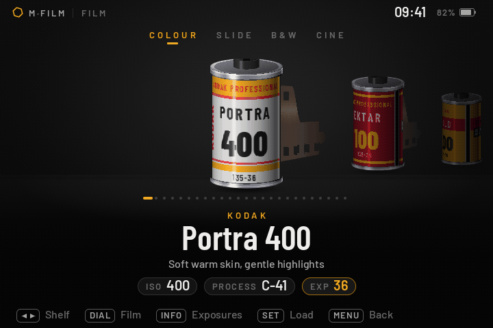

# M-Film, DG11's build

**An unofficial build of [M-Film](https://github.com/HNGSeries/mfilm-canon-film-simulation) for two Canon cameras.**

> [!NOTE]
> This is not the author's release. It is my own build of HNGSeries' M-Film, made and maintained by
> DG11 (davidgorun11). For the original, and for the cameras it supports, go to
> [HNGSeries/mfilm-canon-film-simulation](https://github.com/HNGSeries/mfilm-canon-film-simulation).
> Problems with this build belong [here](https://github.com/davidgorun11/m-film/issues), not with the author.
>
> **Every release here was tested on a real camera before it was published.**

M-Film turns the camera into a film camera. Load a roll from a shelf of films, shoot it, then develop it
in the camera's darkroom.

## Cameras

| Camera | Firmware | Release | Details |
|---|---|---|---|
| EOS&nbsp;6D&nbsp;Mark&nbsp;II | 1.1.1 | [0.2.1&#8209;6d2.3](https://github.com/davidgorun11/m-film/releases/tag/v0.2.1-6d2.3) | [install, what's new, buttons](cameras/6d2/README.md) |
| EOS&nbsp;5D&nbsp;Mark&nbsp;III | 1.2.3 | [0.2.4&#8209;5d3.1](https://github.com/davidgorun11/m-film/releases/tag/v0.2.4-5d3.1) | [install, what's new, buttons](cameras/5d3/README.md) |

> [!WARNING]
> **Each zip is for one camera and one firmware only**, as its name says. Don't put it on any other camera.
> You use it at your own risk.

## Problems

Report them in this repository's [Issues](https://github.com/davidgorun11/m-film/issues), not to the original
M-Film. Say which camera, and attach `ML/FILMROLL.LOG` from the card.

## Credits and license

- **M-Film** is by **HNGSeries**: the film OS, the 72 films and the darkroom. The original, for the other cameras, is at
  [HNGSeries/mfilm-canon-film-simulation](https://github.com/HNGSeries/mfilm-canon-film-simulation).
- It is built on [Magic Lantern](https://www.magiclantern.fm/), on the 6D Mark II through its
  [magiclantern_simplified](https://github.com/reticulatedpines/magiclantern_simplified) port for newer cameras.
- Film colours that are not GPL-2.0 but [CC BY-SA 4.0](https://creativecommons.org/licenses/by-sa/4.0/): film emulation
  tables by [Pat David](https://patdavid.net) (taken through G'MIC and [Film-Luts](https://github.com/YahiaAngelo/Film-Luts)),
  59 films on the 6D Mark II and 53 on the 5D Mark III, and on the 5D Mark III 9 films from
  [spektrafilm](https://github.com/andreavolpato/spektrafilm) by Andrea Volpato. The 4 cinema print films use
  Juan Melara's tables. Those, the fonts and other parts: [THIRD_PARTY.md](THIRD_PARTY.md).
- License: GPL-2.0 ([LICENSE](LICENSE)). The source of each release is in this repository: the `6d2` branch for the
  6D Mark II, the `5d3-rainbow-fix` branch for the 5D Mark III.
- Not affiliated with Canon, Kodak, Fujifilm or any film maker.
